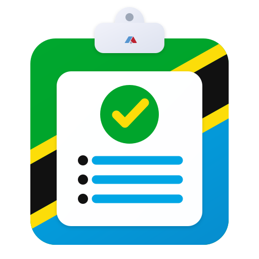
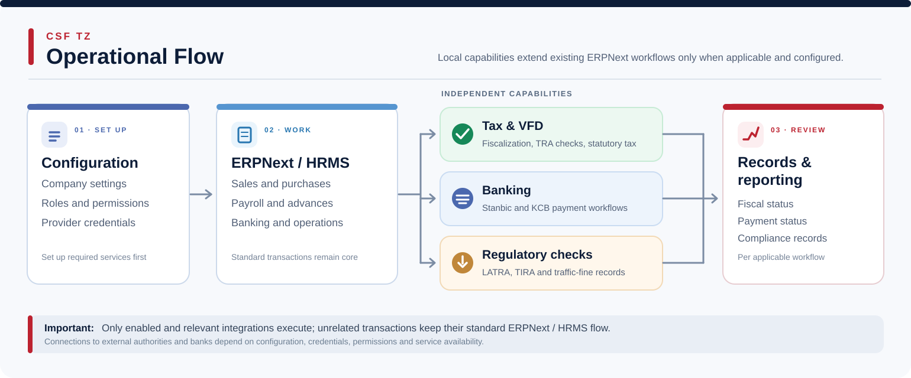

<div align="center">



# CSF TZ

**Country-Specific Functionality for Tanzania**

*Tanzania-focused compliance, fiscal, banking and operational extensions for ERPNext.*

[](https://frappeframework.com/)
[](https://erpnext.com/)
[](license.txt)

</div>

<div align="center">
<p><strong>TRA &amp; VFD Compliance</strong> &nbsp;&nbsp;·&nbsp;&nbsp; <strong>Tax &amp; Accounting</strong> &nbsp;&nbsp;·&nbsp;&nbsp; <strong>HR &amp; Payroll</strong></p>
<p><strong>Banking Integrations</strong> &nbsp;&nbsp;·&nbsp;&nbsp; <strong>Regulatory Verification</strong> &nbsp;&nbsp;·&nbsp;&nbsp; <strong>Operations &amp; Reports</strong></p>
</div>

<p align="right"><sub>by <a href="https://www.aakvatech.com">Aakvatech</a></sub></p>

## About CSF TZ

**CSF TZ** extends the Frappe Framework and ERPNext with country-specific functionality for organizations operating in Tanzania. It helps teams handle tax and fiscal compliance, selected regulatory checks, bank integrations and locally relevant finance, HR and operational processes within familiar ERPNext workflows.

Modules are used according to an organization's needs and configuration. External integrations require the applicable service access and permissions; CSF TZ does not replace standard ERPNext accounting or transaction controls.

## Key Features

- **VFD fiscalization and provider integrations:** Configure supported VFD providers for invoice fiscalization, submission checks and scheduled retries. Provider credentials and company-specific settings govern whether fiscalization is available.

- **Tanzania statutory tax reporting:** Generate supported VAT input and output analyses, withholding tax statements, SDL-related outputs and selected excise reports from the relevant ERPNext accounting and transaction records.

- **TRA verification and localized accounting:** Use supported TRA invoice verification workflows and Tanzania-specific finance extensions, including withholding-tax ledger processing on applicable submitted invoices, while retaining ERPNext's accounting foundation.

- **HR, payroll and employee advances:** Extend employee and payroll processes with supported local workflows such as travel requests and employee advances. HRMS-dependent functions require a compatible HRMS installation.

- **Regulatory and vehicle compliance:** Maintain traffic-fine records and perform supported LATRA and TIRA checks for licensing, offences and insurance cover notes, subject to external authority availability and user permissions.

- **Banking integrations:** Support configured Stanbic payment initiation and SFTP status processing, alongside KCB bank payment files with encryption, where the respective bank arrangements are enabled.

- **Purchasing, sales and stock tools:** Use app-specific workspaces and reports to support purchasing and stock administration, order or shipment tracking, and selected sales and marketing processes without duplicating core ERPNext transactions.

- **Workspace and reporting access:** Organize Tanzanian functions across dedicated Desk workspaces, sidebar navigation and operational or compliance reports, with access controlled by the underlying DocType and report permissions.

## Operational Flow

CSF TZ adds **independent, configurable capabilities** alongside standard ERPNext and HRMS activity. Fiscal, banking and regulatory checks are not mandatory steps of one transaction, and results are recorded against the applicable business workflow.



## ERPNext & Optional Integrations

| Component | Role | Dependency |
| --- | --- | --- |
| **Frappe Framework v16** | Framework, permissions and Desk | Core |
| **ERPNext v16** | Accounting, selling, buying and stock workflows | Core |
| **Frappe HR / HRMS** | Employee, payroll, leave and advance extensions | Needed for HRMS-related features |
| **VFD providers** | Fiscalization services including TotalVFD, VFDPlus, Simplify and DIRM | Provider access and configuration required |
| **Stanbic / KCB** | Bank-specific payment and status workflows | Bank setup and authorization required |
| **TRA / LATRA / TIRA** | Supported statutory and regulatory verification | External service availability may apply |

**Note:** Listed integrations describe supported connection points; they do not mean each external service is enabled automatically or that every organization needs every module.

## Installation

Use the public **`version-16`** branch for Frappe / ERPNext v16 deployments. The technical app name is **`csf_tz`**.

**Prerequisites:** A compatible Frappe v16 and ERPNext v16 bench. The newer Frappe v16 Desk app navigation described by this repository requires **Frappe 16.50+**. Install a compatible HRMS app where HRMS-based functionality is required.

```bash
bench get-app https://github.com/Aakvatech-Limited/csf_tz.git --branch version-16
bench --site your-site install-app csf_tz
bench --site your-site migrate
bench build --app csf_tz
bench restart
```

After installation, open **CSF TZ** in Desk and configure only the company, tax, service-provider and banking features that apply to your organization. Users need the relevant roles and permissions to see and operate each module.

## Support & Contributions

- **Issues and feature requests:** [CSF TZ GitHub Issues](https://github.com/Aakvatech-Limited/csf_tz/issues)
- **Implementation and support:** [Aakvatech Limited](https://www.aakvatech.com) · info@aakvatech.com

Contributions should follow Frappe/ERPNext conventions, avoid unrelated changes to standard ERPNext transactions, respect existing permission controls, and include appropriate tests for business rules and integrations.

## Credits & License

Developed and maintained by **[Aakvatech Limited](https://www.aakvatech.com)** for Tanzania-specific ERPNext requirements.

The repository's [license.txt](license.txt) declares the **MIT License**. The app metadata currently lists GPLv3; this inconsistency should be resolved separately before making any licensing changes.